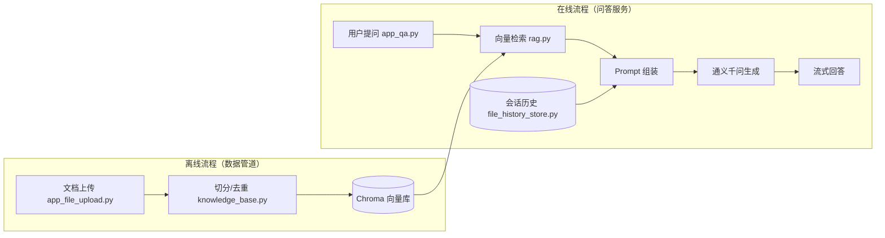

# 🤖 RAG 服装客服知识库系统

基于 **LangChain + Chroma + 通义千问（DashScope）** 的纯 RAG 教学演示项目：将服装领域文档（尺码对照、洗涤养护、颜色选择）向量化入库，用户提问时检索相关片段注入 Prompt，由大模型**严格基于资料**生成专业回答。

## ✨ 核心特性

- 📚 **问答式文档分块**：按"问题边界"切分，片段自带完整问答语义，检索命中率高
- 🔄 **知识库全生命周期管理**：上传去重（md5+文件名）、同名更新（先删后写）、按文件名删除、清空整库
- 💬 **多轮会话记忆**：对话历史持久化到 JSONL 文件，重启不丢失
- 🧩 **离线/在线流程分离**：数据管道与问答服务独立部署、互不干扰
- 🖱️ **三种启动方式**：独立页面或合并页面按需选择

## 🏗️ 架构



> 写入与检索**必须使用同一嵌入模型**（统一由 `config_data.py` 的 `embedding_model` 管理），否则向量空间不一致，检索失效。

## 📁 目录结构

```
.
├── app_main.py            # 合并入口：主区域聊天 + 侧边栏知识库管理（推荐演示用）
├── app_qa.py              # 在线：智能客服聊天页面
├── app_file_upload.py     # 离线：知识库上传与管理页面
├── rag.py                 # 在线：RAG 链（检索→组装→生成→会话记忆）
├── vector_stores.py       # 在线：向量库检索器封装
├── knowledge_base.py      # 离线：知识库写入/删除/清空服务（含命令行工具）
├── file_history_store.py  # 在线：会话历史文件存储
├── config_data.py         # 全局配置（路径锚定、模型名、分块参数）
├── data/                  # 服装领域知识文档（txt）
├── chat_history/          # 运行时产生的会话历史（不入库）
├── chroma_db/             # 向量库持久化目录（可由 data/ 重建，不入库）
├── requirements.txt       # 依赖清单（锁版本）
├── .env.example           # 环境变量模板
└── CHANGELOG.md           # 版本变更记录
```

## 🚀 快速开始

### 1. 环境准备

```powershell
# Python 3.13（其他 3.x 版本亦可，chromadb 在旧 3.13 早期版本需 --prefer-binary，现已正常）
python -m venv .venv
.venv\Scripts\activate
pip install -r requirements.txt
```

### 2. 配置 API Key

参考 [.env.example](.env.example)，设置阿里云百炼的 API Key：

```powershell
setx DASHSCOPE_API_KEY "sk-你的key"   # 设置后重开终端生效
```

### 3. 构建知识库

```powershell
# 方式一：启动管理页面，浏览器上传 data/ 下的文档
streamlit run app_file_upload.py

# 方式二：命令行查看/管理库内文档
python knowledge_base.py --list
python knowledge_base.py --delete 尺码对照表.txt
python knowledge_base.py --clear
```

### 4. 启动问答

```powershell
streamlit run app_qa.py      # 纯聊天页面
streamlit run app_main.py    # 聊天 + 侧边栏知识库管理（推荐）
```

打开浏览器访问 `http://localhost:8501`，试试：

> 我身高180cm体重80kg，穿什么尺码？

## ⚙️ 关键配置（config_data.py）

| 配置项 | 默认值 | 说明 |
|--------|--------|------|
| `embedding_model` | `text-embedding-v4` | 写入/检索共用嵌入模型（改名需重建库） |
| `chat_model_name` | `qwen-max` | 生成回答的大模型 |
| `chunk_size` / `chunk_overlap` | 1000 / 100 | 文本切分参数 |
| `retriever_k` | 2 | 每次检索返回的片段数 |

## 📋 版本历史

| 版本 | 说明 |
|------|------|
| [v2.0.0](releases/tag/v2.0.0) | 合并入口 `app_main.py`；知识库生命周期管理；代码质量修复；发布规范化文件 |
| [v1-course-original](releases/tag/v1-course-original) | 课程学习版：基础问答 + 知识库上传 |

完整变更见 [CHANGELOG.md](CHANGELOG.md)。

## 📄 License

[MIT](LICENSE) © 2026 MackMeng
